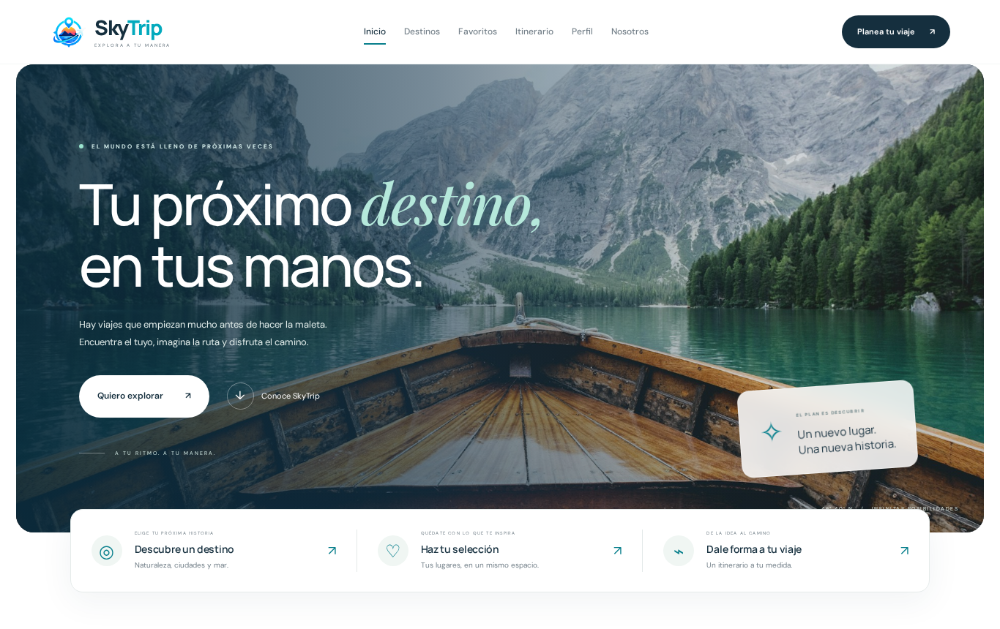
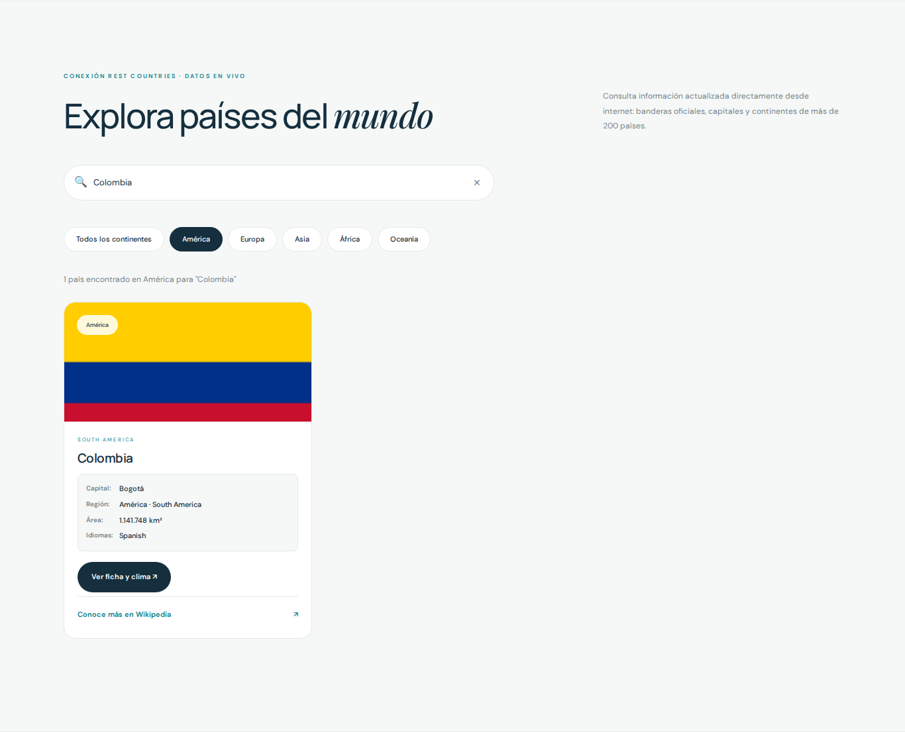
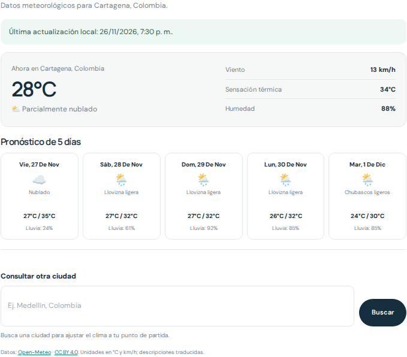
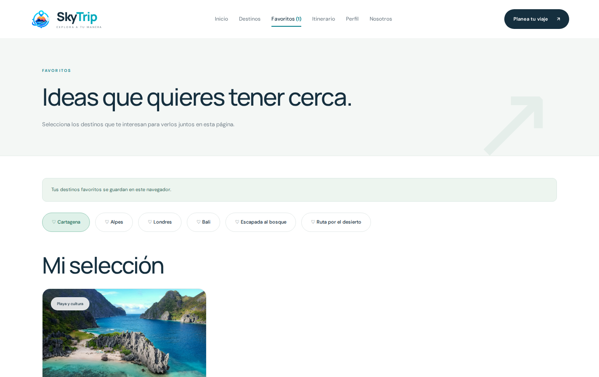
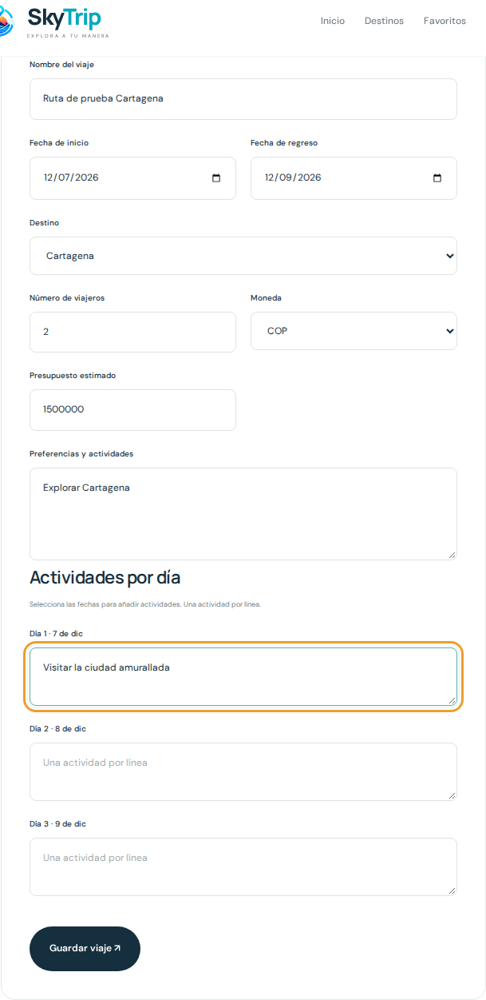
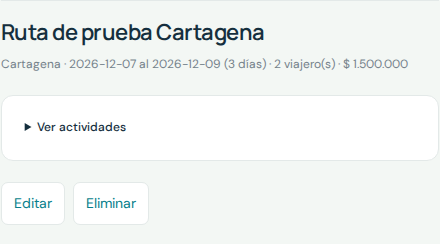

# SKYTRIP — MANUAL DEL USUARIO
**Proyecto académico del tercer corte**  
**Integrantes:** Andrés Tavorda, Eliver Tiapa y Kleiner Madrid  
**Aplicación:** https://david05klai.github.io/proyecto-skytrip/index.html  
**Código fuente:** https://github.com/david05klai/proyecto-skytrip

> Este manual corresponde a la implementación de SkyTrip publicada en el repositorio. Las capturas de la versión local se generan automáticamente en \`docs/capturas/\`. Se necesita acceso a Internet para consultar las APIs públicas.

## 1. Acceso y navegación
1. Abrir el enlace de la aplicación en un navegador moderno.
2. En la barra superior seleccionar **Inicio**, **Destinos**, **Favoritos** o **Itinerario**.
3. En celular abrir el menú desplegable para navegar entre secciones.

## 2. Consultar países con REST Countries
1. Entrar en **Destinos**.
2. Desplazarse hasta **Explora países del mundo**.
3. Esperar a que la API descargue los países; el sitio mostrará un estado de carga.
4. Escribir el nombre o capital en **Buscar país**; por ejemplo, Colombia.
5. Elegir una región (América, Europa, Asia, África u Oceanía) para filtrar.
6. Usar **Mostrar más países** para ampliar las tarjetas visibles.
7. Cada tarjeta informa bandera, nombre, capital, región, población y, según disponibilidad, idiomas.
8. Los datos de países se obtienen de una API externa, por lo que la disponibilidad depende de la conexión.

**Nota:** el catálogo de seis destinos destacados y la sección de países consultados son diferentes. Los favoritos del proyecto se aplican a los seis destinos destacados.

## 3. Ver detalles y clima
1. Abrir **Destinos**.
2. Elegir uno de los destinos destacados y pulsar **Descubrir destino**.
3. Desplegar **Clima y temporada**. La aplicación intenta consultar las condiciones actuales de la ubicación asociada al destino y el pronóstico de cinco días.
4. Leer temperatura, sensación térmica, humedad, viento y pronóstico.
5. Para conocer otra ciudad, escribir su nombre en el buscador del clima y pulsar **Buscar**. La aplicación usa la geocodificación de Open-Meteo para buscar sus coordenadas.
6. Si falla la solicitud, comprobar Internet y utilizar **Reintentar consulta**, cuando esté disponible.

## 4. Guardar y eliminar favoritos
1. En **Inicio**, **Destinos** o la ficha de un destino destacado, pulsar **Guardar en favoritos**.
2. Entrar en **Favoritos** para consultar los destinos elegidos.
3. Para agregar o quitar, marcar/desmarcar una casilla o usar el botón del destino.
4. Recargar la página: los favoritos permanecen en ese navegador, gracias a \`localStorage\`.
5. No se crean cuentas ni se sincronizan favoritos entre dispositivos.

## 5. Crear un itinerario
1. Abrir **Itinerario**.
2. Completar **Nombre del viaje**, **Fecha de inicio**, **Fecha de regreso** y **Destino**.
3. Indicar **Número de viajeros**, **Presupuesto estimado** y **Moneda**.
4. Escribir notas opcionales en **Preferencias y actividades**.
5. Al seleccionar las fechas aparecen campos para escribir las actividades de cada día (una por línea).
6. Pulsar **Guardar viaje**. Se deben usar fechas válidas, regreso no anterior al inicio, presupuesto positivo y una duración máxima de 60 días.

## 6. Consultar, editar y eliminar viajes
1. En **Viajes guardados**, localizar el viaje.
2. Usar **Ver actividades** para revisar lo planeado día a día.
3. Pulsar **Editar** para recuperar sus valores en el formulario, cambiar y **Guardar cambios**.
4. Pulsar **Eliminar** y confirmar para borrarlo.
5. Los itinerarios están almacenados únicamente en el navegador; borrar sus datos o cambiar de dispositivo puede eliminar el historial.

## 7. Uso desde celular
El diseño se adapta a pantallas pequeñas. El menú superior pasa a un menú móvil y las tarjetas se reorganizan.

## 8. Problemas frecuentes
- **Los países no cargan:** revisar acceso a Internet y reintentar. REST Countries y sus fuentes alternativas son servicios externos.
- **No aparece el clima:** confirmar que la ciudad existe y que el navegador puede conectarse a Open-Meteo.
- **Los favoritos desaparecieron:** podrían haberse borrado los datos del sitio o estar usando navegación privada, otro perfil o dispositivo.
- **No guarda el itinerario:** comprobar todos los campos obligatorios, la secuencia de fechas y que el navegador permita usar almacenamiento local.
- **No es una plataforma de reservas:** SkyTrip no compra tiquetes ni administra pagos reales. Sus formularios de contacto y perfil son demostrativos.

## 9. Privacidad y alcance
La planificación y los favoritos se guardan localmente en el navegador mediante \`localStorage\`. La aplicación no requiere cuenta ni servidor de datos propio. Para consultar información externa se hacen solicitudes a servicios públicos de países y clima. Las imágenes de destinos son ilustrativas y el clima depende de datos externos cambiantes.
